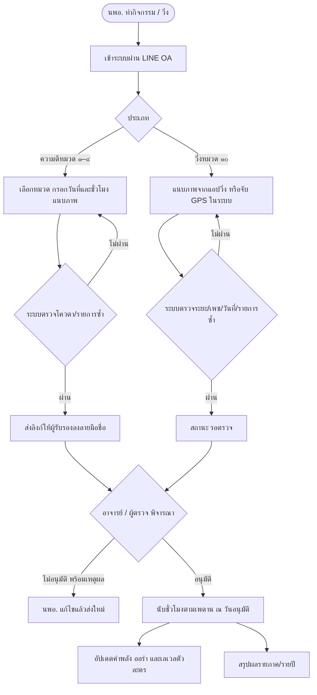

# ระเบียบปฏิบัติประจำ (SOP)
## การบันทึก การรับรอง และการประเมินผลกิจกรรมความดีจิตอาสา และการวิ่งเพื่อสุขภาพ ของนักเรียนพยาบาลทหารอากาศ
### วิทยาลัยพยาบาลทหารอากาศ กรมแพทย์ทหารอากาศ ปีการศึกษา ๒๕๖๙

---

| การควบคุมเอกสาร | รายละเอียด |
| :--- | :--- |
| รหัสเอกสาร | SOP-RTAFNC-GD-2569 |
| ฉบับที่ | ๒.๑ (ร่าง — รอผู้มีอำนาจลงนามประกาศใช้) |
| ฉบับก่อนหน้า | ๑.๐ (เก็บที่ `docs/SOP_v1.0_archive.md`) |
| ระยะเวลาบังคับใช้ | ๑ กรกฎาคม ๒๕๖๙ – ๓๐ มิถุนายน ๒๕๗๐ |
| หน่วยงานเจ้าของกระบวนการ | งานปกครอง นพอ. / กองการศึกษา วพอ.พอ. |
| ระบบสารสนเทศที่เกี่ยวข้อง | ระบบบันทึกความดีจิตอาสา วพอ. ผ่าน LINE Official Account และเว็บ |
| ชั้นความลับ | ใช้ภายในวิทยาลัย (ภาคผนวก จ เป็นข้อมูลสำหรับผู้ดูแลระบบเท่านั้น) |

### ประวัติการแก้ไข

| ฉบับที่ | วันที่ | สาระสำคัญ |
| :---: | :--- | :--- |
| ๑.๐ | ก.ค. ๒๕๖๙ | ประกาศใช้ครั้งแรก — การบันทึกความดี ๙ หมวด ลายมือชื่อดิจิทัล การเลื่อนชั้นปี |
| ๒.๐ | ๑๑ พ.ย. ๒๕๖๙ | เพิ่มหมวด ๑๐ วิ่งเพื่อสุขภาพ, การทดสอบสมรรถภาพ, ค่าพลังรายคน, ฐานข้อมูลรายบุคคล, การคุ้มครองข้อมูลส่วนบุคคล และการดูแลระบบ; ปรับโครงสร้างเอกสารและตัวชี้วัด |
| ๒.๑ | ๑๑ พ.ย. ๒๕๖๙ | แยกหมวด ๑๐ เป็น ๑๐.๑ วิ่งส่วนตัว / ๑๐.๒ งานวิ่ง พร้อมอัตราและเพดานที่เสนอ; เพิ่มกติกาเพซขั้นต่ำ เพดานรายปี ชั้นปีที่ ๔ และการคุ้มครองข้อมูลบน GitHub |

---

## ๑. วัตถุประสงค์

๑.๑ กำหนดวิธีปฏิบัติที่เป็นมาตรฐานเดียวกันในการบันทึก ตรวจสอบ รับรอง และประเมินผลกิจกรรมความดีจิตอาสาของ นพอ. ให้โปร่งใสและตรวจสอบย้อนหลังได้ทุกรายการ

๑.๒ ส่งเสริมให้ นพอ. ทุกนายบำเพ็ญประโยชน์ไม่น้อยกว่า **๕๐ ชั่วโมงต่อปีการศึกษา** โดยมีชั่วโมงพื้นฐาน ๒๕ ชั่วโมงต่อภาคการศึกษา

๑.๓ ส่งเสริมสมรรถภาพร่างกายของ นพอ. ผ่านกิจกรรมวิ่งเพื่อสุขภาพ (หมวด ๑๐) และการทดสอบสมรรถภาพประจำภาค โดยทุกรายการต้องผ่านการอนุมัติของผู้ตรวจก่อนนับผล

๑.๔ กำหนดการจัดเก็บข้อมูลรายบุคคลให้ถูกต้อง ครบถ้วน และสอดคล้องกับพระราชบัญญัติคุ้มครองข้อมูลส่วนบุคคล พ.ศ. ๒๕๖๒

## ๒. ขอบเขต

ใช้กับ นพอ. ชั้นปีที่ ๑–๔ (ปีการศึกษา ๒๕๖๙: รุ่น ๖๙ / ๖๘ / ๖๗ / ๖๖), อาจารย์ผู้ควบคุมและอาจารย์ประจำชั้นปี, ผู้รับรองกิจกรรม (อาจารย์ ผู้ปกครอง หน่วยงานภายนอก), ผู้ตรวจการวิ่งและสมรรถภาพ และผู้ดูแลระบบสารสนเทศ

## ๓. คำนิยาม

| คำ | ความหมาย |
| :--- | :--- |
| รายการความดี | การบันทึกกิจกรรม ๑ ครั้งของ นพอ. ในหมวด ๑–๙ |
| รายการวิ่ง | การบันทึกการวิ่ง ๑ ครั้งในหมวด ๑๐ พร้อมหลักฐาน |
| สถานะรอตรวจ | รายการที่ส่งแล้วแต่ยังไม่ได้รับอนุมัติ **ไม่นับชั่วโมงและไม่นับค่าพลัง** |
| ผู้ตรวจ | อาจารย์หรือเจ้าหน้าที่ที่ได้รับมอบหมายและได้รับรหัสผู้ตรวจจากผู้ดูแลระบบ |
| ค่าพลัง | คะแนนพัฒนาตนเองรายคน (เต็ม ๑,๐๐๐) ใช้เพื่อสร้างแรงจูงใจ **ไม่ใช่ผลการประเมินทางวิชาการ** |
| แต้มบุญ / ออร่า | ชั่วโมงความดีหมวด ๑–๙ รวมกับชั่วโมงวิ่งที่อนุมัติแล้ว ใช้กำหนดระดับออร่าของตัวละคร |
| เลเวลตัวละคร (chibi) | ระดับ ๑–๑๐ คำนวณจากค่าพลัง (ทุก ๑๐๐ คะแนน = ๑ ระดับ) |

## ๔. บทบาทและความรับผิดชอบ (RACI)

| กระบวนการ | นพอ. | ผู้รับรอง | อาจารย์ประจำชั้น / ผู้ตรวจ | ผู้ดูแลระบบ |
| :--- | :---: | :---: | :---: | :---: |
| ๑. ปฏิบัติกิจกรรมและเก็บหลักฐาน | R | C | I | – |
| ๒. บันทึกรายการความดีหรือรายการวิ่งในระบบ | R | I | I | C |
| ๓. ลงลายมือชื่อรับรองรายการความดี | I | R | C | – |
| ๔. ตรวจสอบและอนุมัติ/ไม่อนุมัติ | I | – | A/R | C |
| ๕. บันทึกผลทดสอบสมรรถภาพ | I | – | A/R | – |
| ๖. กำหนดกติกาหมวด ๑๐ (อัตรา เพดาน ช่วงภาค) | – | – | A | R |
| ๗. สรุปผลรายภาค/ปี และเลื่อนชั้นปี | I | – | A | R |
| ๘. ดูแลความปลอดภัย สำรองข้อมูล และรหัสลับของระบบ | – | – | I | A/R |

R = ผู้ปฏิบัติ, A = ผู้รับผิดชอบผลและมีอำนาจตัดสินใจ, C = ผู้ให้คำปรึกษา, I = ผู้รับทราบ

## ๕. ภาพรวมกระบวนการ

## ๖. ขั้นตอนการปฏิบัติงาน

### SOP-GD-01 การเข้าสู่ระบบและข้อมูลประจำตัว
๑. เข้าใช้งานผ่านเมนูใน LINE Official Account ของวิทยาลัย (แนะนำ) หรือผ่านเว็บเบราว์เซอร์

๒. กรอกรหัสนักเรียน ๗ หลัก รหัสผ่านเริ่มต้นคือรหัสนักเรียน

๓. **เปลี่ยนรหัสผ่านทันทีเมื่อเข้าใช้งานครั้งแรก** ที่เมนู "โปรไฟล์" และตรวจสอบชื่อ-สกุล ชั้นปี ให้ถูกต้อง

๔. ห้ามให้ผู้อื่นใช้บัญชีแทน และห้ามบันทึกรายการแทนผู้อื่น

### SOP-GD-02 การบันทึกความดี ๙ หมวดและเพดานชั่วโมง

| หมวด | ชื่อหมวด | เพดานต่อครั้ง/วัน | เพดานสะสม | หลักฐาน/เงื่อนไข |
| :---: | :--- | :---: | :---: | :--- |
| ๑ | บริจาคโลหิต/เกล็ดเลือด/พลาสมา | ๘ ชม./ครั้ง | ๔ ครั้ง/ปี | เว้นระยะอย่างน้อย ๙๐ วัน; ภาพสมุดบริจาคหรือหลักฐานสภากาชาด |
| ๒ | โครงการภายนอก (คำสั่ง วพอ.) | ๘ ชม./วัน | ตามคำสั่ง | ระบุเลขที่คำสั่ง |
| ๓ | ช่วยเหลืองานภายใน วพอ. | ๘ ชม./วัน | ตามงานที่มอบหมาย | รวมกิจกรรม ๕ส และเวรจิตอาสา |
| ๔ | เข้าอบรมที่ วพอ. จัดให้ | ๔ ชม./วัน | ตามเวลาอบรม | ไม่นับวิชาเรียนตามหลักสูตร |
| ๕ | ช่วยงานหน่วยงาน/ชุมชน/มูลนิธิ | ๔ ชม./วัน | ตามเวลาจริง | – |
| ๖ | ทำนุบำรุงศาสนสถาน | ๑ ชม./ครั้ง | ๔ ชม./ปี | – |
| ๗ | งานฟรีทั่วไป/ช่วยผู้ปกครอง | ๑ ชม./ครั้ง | ๒ ชม./ภาค, ๔ ชม./ปี | – |
| ๘ | กิจกรรมจงรักภักดีต่อสถาบัน | ดูหมายเหตุ | ๘ ชม./ปี | จิตอาสาพระราชทาน พิธีถวายพระพร |
| ๙ | บทบาทหน้าที่พิเศษ | – | ๒๐ ชม./ภาค, ๔๐ ชม./ปี | อาจารย์เป็นผู้ให้หลังตรวจสอบก่อนปิดภาค; มีหลายตำแหน่งรับได้ ๑ ตำแหน่ง |

> **หมายเหตุหมวด ๘:** SOP ฉบับ ๑.๐ ระบุ ๔ ชม./ครั้ง แต่ระบบกำหนดไว้ ๘ ชม./ครั้ง — รอผู้รับผิดชอบยืนยันตัวเลขที่ถูกต้องตามข้อกำหนดของวิทยาลัย

ระบบจะปฏิเสธรายการซ้ำ (หมวดเดียวกัน วันเดียวกัน) และแสดงชั่วโมงคงเหลือของแต่ละหมวดก่อนส่ง

### SOP-GD-03 การขอรับรองและลงลายมือชื่อดิจิทัล
๑. เมื่อส่งรายการ ระบบสร้างลิงก์รับรองเฉพาะรายการ ให้ นพอ. ส่งลิงก์ให้ผู้รับรองทาง LINE หรือช่องทางอื่น

๒. ผู้รับรองเปิดลิงก์ ตรวจภาพ รายละเอียด วันที่ และชั่วโมง เลือกสถานะของตน (อาจารย์ / ผู้ปกครอง / หน่วยงานภายนอก / อื่น ๆ) พิมพ์ชื่อ-ตำแหน่ง และลงลายมือชื่อบนหน้าจอ

๓. ระบบบันทึกลายมือชื่อพร้อมเวลา และส่งรายการเข้าหน้าตรวจของอาจารย์

### SOP-GD-04 การตรวจและอนุมัติรายการความดี (อาจารย์)
๑. ตรวจภาพหลักฐาน ความถูกต้องของหมวด และลายมือชื่อผู้รับรอง

๒. อนุมัติรายบุคคล หรืออนุมัติทั้งกลุ่มสำหรับกิจกรรมที่มีคำสั่ง วพอ.

๓. **การไม่อนุมัติต้องระบุเหตุผลทุกครั้ง** เพื่อให้ นพอ. แก้ไขและส่งใหม่

๔. ระยะเวลามาตรฐาน: ตรวจให้แล้วเสร็จภายใน **๗ วันทำการ** นับจากวันที่ส่ง

### SOP-GD-05 รอบปีการศึกษา การยกยอด และใบบันทึกความดี
๑. ภาคการศึกษาที่ ๑: ๑ ก.ค. – ๓๐ พ.ย. / ภาคการศึกษาที่ ๒: ๑ ธ.ค. – ๓๐ มิ.ย.

๒. ระบบใช้ ๒ มาตรวัด: **ยอดประจำปี** (เริ่มนับใหม่ ๑ ก.ค. เพื่อประเมินเกณฑ์ ๕๐ ชม.) และ **ยอดสะสมตลอดหลักสูตร** (ไม่ลบข้อมูลเดิม)

๓. วันที่ ๑ ก.ค. ของทุกปี ผู้ดูแลระบบนำเข้ารายชื่อรุ่นใหม่ เลื่อนชั้นปี และย้ายชั้นปีที่ ๔ ที่สำเร็จการศึกษาเป็นศิษย์เก่า โดยเก็บประวัติไว้เป็นฐานสถิติ

๔. รายการที่อนุมัติแล้วพิมพ์ใบบันทึกความดีขนาด A4 ได้จากหน้า "ใบบันทึกความดี"

### SOP-GD-06 หมวด ๑๐ วิ่งเพื่อสุขภาพ
**ก. การบันทึก (นพอ.)** — เมนู "วิ่งเพื่อสุขภาพ & ค่าพลัง" เลือกได้ ๒ วิธี

| วิธี | ขั้นตอน | ข้อควรระวัง |
| :--- | :--- | :--- |
| ภาพจากแอปวิ่ง | ถ่ายภาพหน้าจอสรุปผล (Strava, Garmin, Nike Run Club หรือนาฬิกา) ที่เห็นวันที่ ระยะทาง และเวลาชัดเจน แล้วกรอกระยะทางและเวลาให้ตรงกับภาพ | ตัวเลขที่กรอกต้องตรงกับภาพ มิฉะนั้นผู้ตรวจจะไม่อนุมัติ |
| จับ GPS ในระบบ | กด "เริ่มวิ่ง" อนุญาตตำแหน่ง เปิดหน้าจอค้างไว้ระหว่างวิ่ง กด "พัก" เมื่อหยุด และ "จบการวิ่ง" เมื่อเสร็จ ระบบสร้างภาพเส้นทางเป็นหลักฐานให้อัตโนมัติ | หากปิดหน้าจอหรือสลับแอป LINE อาจหยุดรับตำแหน่ง ทำให้ระยะขาดหาย |

**ข. การตรวจสอบอัตโนมัติก่อนรับรายการ**
- ระยะทาง ๐.๕ – ๔๒.๒ กม. ต่อครั้ง
- เพซต้องอยู่ระหว่าง ๓ – ๒๐ นาที/กม. (เร็วกว่านี้ถือว่าผิดปกติ เช่น ปั่นจักรยานหรือนั่งรถ)
- ห้ามเป็นวันในอนาคต และส่งย้อนหลังได้ไม่เกิน ๗ วัน
- ต้องมีภาพหลักฐานทุกครั้ง และห้ามส่งซ้ำ (วันเดียวกัน ระยะเท่ากัน)
- ในโหมด GPS ระบบตัดช่วงที่เร็วเกิน ๒๕ กม./ชม. และจุดที่สัญญาณคลาดเคลื่อนเกิน ๓๕ เมตร

**ค. การคิดชั่วโมง (ข้อเสนอ — รอผู้มีอำนาจอนุมัติ)**

หลักคิด: ข้อกำหนดฯ ปีการศึกษา ๒๕๖๕ ไม่มีหมวดการวิ่ง และกิจกรรมที่ทำเองโดยไม่มีคำสั่ง (หมวด ๗ ความดีทั่วไป) ได้โควตาน้อยที่สุด การวิ่งส่วนตัวเป็นประโยชน์ต่อตนเองมากกว่าส่วนรวม จึงกำหนดให้ **ได้ชั่วโมงใกล้เคียงหมวด ๗ และรวมทั้งปีไม่เกินร้อยละ ๑๒ ของเกณฑ์ ๕๐ ชม./ปี (๖ ชม.)** เพื่อไม่ให้แทนที่งานจิตอาสาจริง ส่วนแรงจูงใจหลักของการวิ่งอยู่ที่ค่าพลังและเลเวลตัวละคร

| ประเภท | การคิดชั่วโมง | เพดาน | หลักฐาน |
| :--- | :--- | :--- | :--- |
| **๑๐.๑ วิ่งส่วนตัว** | ทุก ๑๐ กม. = ๑ ชม. ปัดลงทีละ ๐.๕ ชม. (๕ กม. = ๐.๕, ๑๐ กม. = ๑ ชม.) | ๑ ชม./วัน · ๓ ชม./ภาค · ๖ ชม./ปี (ชั้นปีที่ ๔: ๔ ชม./ปี) | ภาพหน้าจอแอปวิ่ง หรือภาพเส้นทาง GPS จากระบบ |
| **๑๐.๒ งานวิ่ง / วิ่งการกุศลที่มีผู้จัด** | ๒ ชม./งาน (ระยะตั้งแต่ ๕ กม.) | ๒ งาน/ภาค (๔ ชม./ภาค) แยกจากเพดาน ๑๐.๑ | ภาพเบอร์วิ่ง ใบประกาศ หรือภาพที่เส้นชัย พร้อมระบุชื่องาน |

เหตุผลของตัวเลข: ระยะ ๑๐ กม. ใช้เวลาวิ่งจริงประมาณ ๖๐–๗๐ นาทีสำหรับ นพอ. ทั่วไป (เพซ ๖–๗ นาที/กม.) จึงเทียบได้กับเวลาที่ใช้จริง ๑ ชม.; เพดานวันละ ๑ ชม. กันการสะสมด้วยการวิ่งระยะไกลครั้งเดียว; งานวิ่งที่มีผู้จัดมีส่วนร่วมกับสังคม (ค่าสมัครเข้าการกุศล) จึงได้มากกว่าการวิ่งส่วนตัว

เงื่อนไขเพิ่มเติม
- ได้ชั่วโมงเฉพาะเมื่อเพซไม่ช้ากว่า **๑๐ นาที/กม.** (ช้ากว่านี้ถือเป็นการเดิน บันทึกค่าพลังได้แต่ไม่ได้ชั่วโมง)
- ระยะต่ำกว่า ๕ กม. บันทึกค่าพลังได้ แต่ยังไม่ได้ชั่วโมง
- งานวิ่งที่ไปตาม **คำสั่ง วพอ.** ให้บันทึกในหมวด ๒ (โครงการภายนอก) แทน ห้ามบันทึกซ้ำทั้งสองหมวด
- ชั่วโมงคำนวณและตัดเพดาน **ณ วันที่ผู้ตรวจอนุมัติ** จากรายการที่อนุมัติแล้วเท่านั้น ระหว่างรอตรวจระบบแสดงเพียง "ชั่วโมงโดยประมาณ"
- วันที่วิ่งต้องอยู่ในช่วงภาคเรียนที่กำหนด มิฉะนั้นได้ ๐ ชม.
- หน้า "วิ่งเพื่อสุขภาพ" แสดงชั่วโมงที่ใช้ไปเทียบเพดานของภาคและของปี ให้ นพอ. ตรวจสอบได้เอง
- ผู้ดูแลระบบปรับค่าทุกข้อได้ที่หน้าผู้ตรวจ แท็บ "ตั้งค่ากติกา" มีผลกับการอนุมัติครั้งถัดไป รายการที่อนุมัติแล้วไม่ถูกคำนวณใหม่

**ง. การตรวจและอนุมัติ (ผู้ตรวจ)** — แถบเมนู "ตรวจการวิ่ง & สมรรถภาพ"
๑. กรอกรหัสผู้ตรวจ (ระบบจำไว้เฉพาะแท็บที่เปิดอยู่)

๒. เปิดภาพหลักฐาน เทียบวันที่ ระยะทาง และเวลากับที่ นพอ. กรอก

๓. ตรวจประเภท: หากเป็น ๑๐.๒ ต้องเห็นชื่องานและเบอร์วิ่ง/ใบประกาศ หากเป็นงานตามคำสั่ง วพอ. ให้ไม่อนุมัติพร้อมแนะนำให้บันทึกหมวด ๒

๔. กด "อนุมัติ" (ระบบแจ้งจำนวนชั่วโมงที่ได้จริงหลังตัดเพดาน) หรือ "ไม่อนุมัติ" พร้อมเหตุผล

๕. รายการที่ตรวจแล้วเปลี่ยนสถานะซ้ำไม่ได้ หากตรวจผิดให้แจ้งผู้ดูแลระบบแก้ไขในชีตพร้อมบันทึกเหตุผล

๖. ระยะเวลามาตรฐาน: ตรวจภายใน **๓ วันทำการ**

### SOP-GD-07 การทดสอบสมรรถภาพและค่าพลังรายคน
๑. จัดทดสอบอย่างน้อยภาคการศึกษาละ ๑ ครั้ง ได้แก่ วิ่ง ๒.๔ กม. (นาที:วินาที), ดันพื้น ๒ นาที และลุกนั่ง ๒ นาที

๒. ผู้ตรวจบันทึกผลในแท็บ "สมรรถภาพ" ภายใน ๓ วันทำการหลังการทดสอบ ระบบบันทึกชื่อผู้บันทึกและเวลาโดยอัตโนมัติ

๓. องค์ประกอบค่าพลัง (เต็ม ๑,๐๐๐) — นับเฉพาะรายการที่อนุมัติแล้ว

| ด้าน | คะแนนเต็ม | เกณฑ์เต็ม |
| :--- | :---: | :--- |
| ความอึด | ๒๕๐ | ระยะสะสม ๒๐๐ กม. |
| ความเร็ว | ๑๕๐ | เพซเฉลี่ย ๔:๐๐ นาที/กม. (เริ่มนับเมื่อวิ่งที่อนุมัติแล้วครบ ๓ ครั้ง) |
| ความสม่ำเสมอ | ๑๐๐ | มีการวิ่งครบ ๘ ใน ๘ สัปดาห์ล่าสุด |
| สมรรถภาพร่างกาย | ๒๐๐ | ๒.๔ กม. ≤ ๑๐ นาที, ดันพื้น ≥ ๖๐, ลุกนั่ง ≥ ๖๐ (ผลทดสอบล่าสุด) |
| แต้มบุญ | ๓๐๐ | ชั่วโมงความดี + ชั่วโมงวิ่ง ≥ ๕๐ ชม. |

๔. ระดับออร่าตามแต้มบุญ: ไม่มี (< ๑๐ ชม.) → จาง (๑๐) → เงิน (๒๐) → ทอง (๓๕) → ศักดิ์สิทธิ์ (๕๐ ชม. ขึ้นไป)

๕. ค่าพลัง เลเวล และออร่า **เป็นเครื่องมือสร้างแรงจูงใจ** ไม่ใช้แทนผลการประเมินทางวิชาการหรือการตัดสินทางวินัย

### SOP-GD-08 ฐานข้อมูลรายบุคคลและการคุ้มครองข้อมูลส่วนบุคคล
๑. **แหล่งข้อมูลหลัก:** Google Sheets "ฐานข้อมูลความดี วพอ 2569" และ Google Drive ของวิทยาลัย โดยใช้รหัสนักเรียน ๗ หลักเป็นตัวระบุตัวตนในทุกตาราง

| ตาราง (แท็บ) | เก็บอะไร | ผู้เขียนข้อมูล |
| :--- | :--- | :--- |
| `Main_2569` | ทะเบียนนักเรียนและยอดชั่วโมงหมวด ๑–๙ | ระบบ / ผู้ดูแลระบบ |
| `Deeds_2569` | รายการความดีทุกครั้ง พร้อมสถานะและผู้ตรวจ | ระบบ |
| `Runs_2569` | รายการวิ่งทุกครั้ง: ระยะ เวลา เพซ แหล่งข้อมูล หลักฐาน สถานะ ชั่วโมงที่อนุมัติ ผู้ตรวจ เหตุผล | ระบบ |
| `Fitness_2569` | ผลทดสอบสมรรถภาพรายครั้ง | ผู้ตรวจ |
| `Run_Settings` | กติกาหมวด ๑๐ | ผู้ดูแลระบบ |
| Drive: `ชั้นปี/รหัส - ชื่อ/` | ภาพหลักฐานความดีและการวิ่งรายคน (สิทธิ์ส่วนตัว) | ระบบ |

> ชั่วโมงหมวด ๑๐ เก็บใน `Runs_2569` แยกจาก `Main_2569` เพื่อไม่ให้กระทบสูตรยอดรวมเดิม รายงานยอดรวมจึงต้องนำทั้งสองแหล่งมารวมกัน

๒. **หลักการคุ้มครองข้อมูล**
- เก็บเท่าที่จำเป็น: รายการวิ่งโหมด GPS เก็บเพียงสรุป (จำนวนจุด เวลาเริ่ม-สิ้นสุด) และภาพเส้นทาง ไม่เก็บพิกัดดิบทั้งหมด
- นพอ. เห็นได้เฉพาะข้อมูลของตนเองและหน้าจัดอันดับ; ข้อมูลนักเรียนทุน ทอ. เห็นได้เฉพาะผู้ดูแลระบบ
- **ห้าม** ใส่รหัสผ่าน เบอร์โทร อีเมล หรือ chat id ในไฟล์ที่เผยแพร่บนเว็บ ทุกครั้งที่สร้างไฟล์รายชื่อใหม่ให้รัน `python3 scripts/strip_public_student_pii.py` ก่อนเผยแพร่
- **ห้าม** นำชื่อ รหัสนักเรียน อีเมล เบอร์โทร LINE user id หรือ Telegram chat id จริงลงในเอกสารหรือโค้ดบน GitHub ใช้ค่าสมมติ (เช่น `XXXXXXX`) ในตัวอย่างและการทดสอบ รายชื่อตามคำสั่งเก็บใน `data/private/`
- ก่อน commit ทุกครั้งให้รัน `PII_GUARD_MODE=full node scripts/pii-guard.mjs` และตรวจผลด้วยตนเอง
- การแก้ไขข้อมูลที่อนุมัติแล้วต้องทำโดยผู้ดูแลระบบ พร้อมบันทึกเหตุผล ห้ามลบแถว ให้เปลี่ยนสถานะและหมายเหตุแทน

๓. **การเก็บรักษา:** ข้อมูลของรุ่นที่สำเร็จการศึกษาเก็บเป็นฐานสถิติศิษย์เก่า ภาพหลักฐานเก็บตลอดหลักสูตรและ ๑ ปีหลังสำเร็จการศึกษา หรือตามที่วิทยาลัยกำหนด

### SOP-GD-09 การดูแลระบบ (ผู้ดูแลระบบ)
๑. **รหัสลับของระบบ** เก็บใน Cloudflare (Encrypted variables) และ Apps Script (Script Properties) เท่านั้น ห้ามใส่ในโค้ด แชต หรือเอกสาร รายการที่ต้องมี: `GAS_URL`, `RUN_ADMIN_KEY`, `RUN_GATEWAY_KEY` (ค่าเดียวกันทั้งสองฝั่ง), `TELEGRAM_BOT_TOKEN`, `LINE_CHANNEL_ACCESS_TOKEN`

๒. **การเปลี่ยนรหัสผู้ตรวจ:** เปลี่ยน `RUN_ADMIN_KEY` ทุกภาคการศึกษา และทันทีเมื่อมีผู้ตรวจพ้นหน้าที่หรือสงสัยว่ารั่ว

๓. **การนำขึ้นระบบ (deploy):** ทดสอบตามลำดับ — `node scripts/check-syntax.cjs` → `node --test tests/*.test.cjs` → `node scripts/pii-guard.mjs` — ทุกขั้นต้องผ่านก่อน deploy และบันทึกการเปลี่ยนแปลงใน `docs/` ทุกครั้ง

๔. **การสำรองข้อมูล:** ทำสำเนา Google Sheets ทุกสิ้นเดือนและก่อนการเลื่อนชั้นปี เก็บในโฟลเดอร์ Drive ที่จำกัดสิทธิ์

## ๗. ตัวชี้วัดและจุดควบคุม

| ตัวชี้วัด | เป้าหมาย | ผู้ติดตาม |
| :--- | :---: | :--- |
| รายการความดีตรวจเสร็จภายใน ๗ วันทำการ | ≥ ๙๕% | อาจารย์ประจำชั้น |
| รายการวิ่งตรวจเสร็จภายใน ๓ วันทำการ | ≥ ๙๕% | ผู้ตรวจ |
| รายการไม่อนุมัติที่มีเหตุผลประกอบ | ๑๐๐% | ผู้ดูแลระบบ |
| นพอ. ที่มีผลทดสอบสมรรถภาพในภาคการศึกษา | ๑๐๐% | ผู้ตรวจ |
| นพอ. ผ่านเกณฑ์ ๕๐ ชม./ปี | ≥ ๙๐% | งานปกครอง |
| เหตุข้อมูลส่วนบุคคลรั่วไหล | ๐ ครั้ง | ผู้ดูแลระบบ |

## ๘. การจัดการเหตุขัดข้อง

| รหัส | เหตุการณ์ | การดำเนินการ |
| :---: | :--- | :--- |
| EX-01 | โควตาหมวดเต็ม | ตรวจชั่วโมงคงเหลือ และบันทึกในหมวดที่ยังมีโควตา |
| EX-02 | ระบบแจ้งรายการซ้ำ | ตรวจประวัติ หากเป็นกิจกรรมวันเดียวกันให้รวมเป็นรายการเดียว |
| EX-03 | บริจาคโลหิตยังไม่ครบ ๙๐ วัน | รอให้ครบระยะห่างตามมาตรฐาน |
| EX-04 | รายการถูกปฏิเสธ | อ่านเหตุผล แก้หลักฐานให้ถูกต้อง แล้วส่งใหม่ |
| EX-05 | ลืมรหัสผ่าน | แจ้งอาจารย์ประจำรุ่นหรือผู้ดูแลระบบเพื่อรีเซ็ต แล้วเปลี่ยนรหัสใหม่ทันที |
| EX-06 | ผู้รับรองเปิดลิงก์ไม่ได้ | เปิดด้วยเบราว์เซอร์ปกติ หรือคัดลอกลิงก์ส่งใหม่ |
| EX-07 | เพซผิดปกติ / ระยะเกินกำหนด | ตรวจตัวเลขที่กรอกให้ตรงกับภาพ หากเป็นการวิ่งจริงที่เร็วมากให้แจ้งผู้ตรวจพร้อมหลักฐาน |
| EX-08 | GPS ไม่บันทึก / ระยะขาดหาย | เปิดหน้าจอค้างไว้ระหว่างวิ่ง หรือใช้วิธี "ภาพจากแอปวิ่ง" แทน |
| EX-09 | ส่งรายการวิ่งย้อนหลังเกิน ๗ วัน | ระบบไม่รับ ให้แจ้งผู้ตรวจพร้อมเหตุผลความจำเป็น |
| EX-12 | วิ่งแล้วได้ ๐ ชม. | ตรวจหมายเหตุผู้ตรวจ: ครบเพดานวัน/ภาค/ปี, เพซช้ากว่า ๑๐ นาที/กม., ระยะต่ำกว่า ๕ กม. หรือครบโควตางานวิ่ง — ค่าพลังยังนับตามปกติ |
| EX-10 | หน้าระบบวิ่งแจ้ง "ยังไม่เปิดใช้งาน" | ผู้ดูแลระบบตรวจรหัสลับ `RUN_GATEWAY_KEY` ทั้งสองฝั่งให้ตรงกัน |
| EX-11 | สงสัยข้อมูลส่วนบุคคลรั่วไหล | ผู้ดูแลระบบระงับการเผยแพร่ไฟล์ที่เกี่ยวข้องทันที บันทึกเหตุ แจ้งผู้บังคับบัญชา และดำเนินการตาม พ.ร.บ.คุ้มครองข้อมูลส่วนบุคคล |

## ๙. เอกสารและบันทึกที่เกี่ยวข้อง

- ภาคผนวก ก: ข้อกำหนดการบันทึกชั่วโมงความดีจิตอาสาผ่าน LINE Official "นพอ.ประจำวัน" (`docs/`)
- ภาคผนวก ข: คู่มือการใช้งานบนเว็บ (`frontend/manual.html`)
- ภาคผนวก ค: ใบบันทึกความดี A4 (`frontend/deed_slip.html`)
- ภาคผนวก ง: เอกสารเทคนิคหมวด ๑๐ และการติดตั้ง (`docs/RUN_TRACKER.md`)
- ภาคผนวก จ: รายการรหัสลับและการตั้งค่า (ผู้ดูแลระบบเท่านั้น — เก็บนอก GitHub)

---

| | ผู้จัดทำ | ผู้ตรวจสอบ | ผู้อนุมัติ |
| :--- | :---: | :---: | :---: |
| ลงชื่อ | ........................................ | ........................................ | ........................................ |
| ตำแหน่ง | ผู้ดูแลระบบสารสนเทศ | หัวหน้างานปกครอง นพอ. | ผู้อำนวยการวิทยาลัยพยาบาลทหารอากาศ |
| วันที่ | ...... / ...... / ...... | ...... / ...... / ...... | ...... / ...... / ...... |
